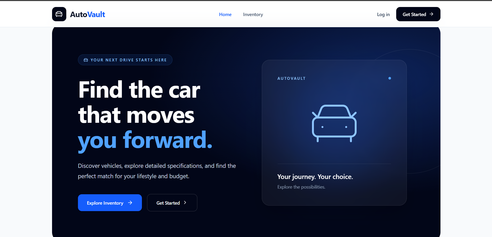
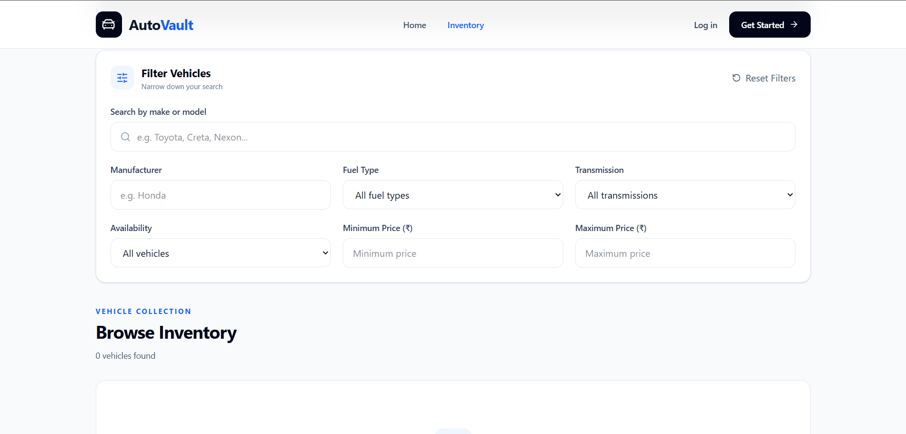
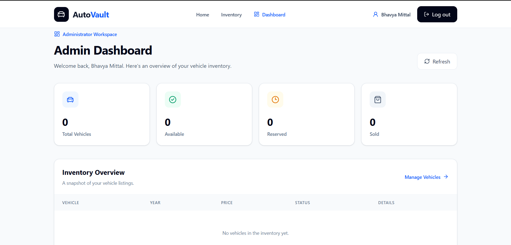
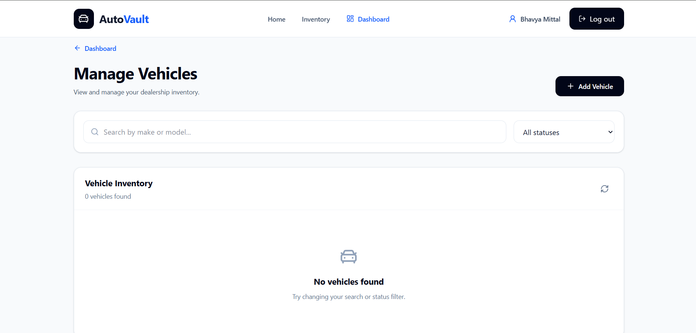

# AutoVault — Car Dealership Inventory Management System

A full-stack car dealership inventory management application built with **React, TypeScript, Node.js, Express, and PostgreSQL**.

AutoVault provides a responsive platform for customers to explore vehicle listings and a secure administrator dashboard for managing dealership inventory.

The application was developed using test-driven development (TDD), with automated tests covering authentication, authorization, database operations, API validation, and frontend functionality.

## Live Application

- **Live Website:** https://car-dealership-inventory-kappa.vercel.app
- **Backend API:** https://autovault-api-31z5.onrender.com/api/health
- **GitHub Repository:** https://github.com/BMittal09/car-dealership-inventory

> The backend runs on Render's free hosting tier, so the first API request after inactivity may take additional time.

## Application Screenshots

### Homepage



### Vehicle Inventory



### Administrator Dashboard



### Vehicle Management



---
## Features

### Customer Features

- Browse dealership vehicle inventory.
- Search vehicles by manufacturer or model.
- Filter vehicles by make, fuel type, transmission, availability, and price range.
- View detailed information about individual vehicles.
- Browse paginated vehicle listings.
- Register and log in securely.
- Access a responsive interface across desktop and mobile devices.

### Administrator Features

- Secure administrator dashboard with live inventory statistics.
- View total, available, reserved, and sold vehicles.
- Add new vehicles to the inventory.
- Edit vehicle details, prices, and mileage.
- Update vehicle availability status.
- Permanently delete vehicles with confirmation.
- Search, filter, and paginate vehicle records.
- Receive success and error notifications after inventory operations.

### Authentication and Security

- JWT-based authentication with one-hour access tokens.
- Argon2id password hashing.
- Role-based access control for administrator operations.
- Backend verification of current administrator permissions.
- Authentication rate limiting.
- Request validation using Zod.
- Parameterized PostgreSQL queries.
- HTTP security headers using Helmet.
- Configurable CORS.
- Automatic JWT expiration handling.
- Authentication cache cleanup on logout.
- Centralized API error handling.
- Graceful server shutdown.

## Technology Stack

| Layer               | Technologies                         |
| ------------------- | ------------------------------------ |
| Frontend            | React 19, TypeScript, Vite 8         |
| Styling             | Tailwind CSS 4, Lucide React         |
| Routing             | React Router                         |
| Server State        | TanStack Query                       |
| Backend             | Node.js, Express 5, TypeScript       |
| Database            | PostgreSQL                           |
| Authentication      | JWT (JOSE), Argon2id                 |
| Validation          | Zod                                  |
| Frontend Testing    | Vitest, React Testing Library, jsdom |
| Backend Testing     | Vitest, Supertest                    |
| Database Migrations | node-pg-migrate                      |
| Frontend Deployment | Vercel                               |
| Backend Deployment  | Render                               |
| Database Hosting    | Neon PostgreSQL                      |

## System Architecture

```text
                     USER / ADMIN
                          |
                          v
                 React + TypeScript
                    Tailwind CSS
                          |
                          v
                     React Router
                          |
                          v
                    TanStack Query
                          |
                          v
                     Vercel CDN
                          |
                     /api/* Proxy
                          |
                          v
                   Express REST API
                      (Render)
                          |
             +------------+------------+
             |                         |
             v                         v
      Authentication API         Vehicle API
             |                         |
      JWT + Argon2id             CRUD Operations
             |                         |
             +------------+------------+
                          |
                          v
                    PostgreSQL
                       (Neon)
```

The React frontend communicates with the Express backend through REST APIs.

In production, Vercel rewrites `/api/*` requests to the Render backend. The backend handles validation, authentication, authorization, and database operations.

## REST API Endpoints

### Authentication

| Method | Endpoint             | Description                         |
| ------ | -------------------- | ----------------------------------- |
| POST   | `/api/auth/register` | Register a new user                 |
| POST   | `/api/auth/login`    | Authenticate and receive a JWT      |
| GET    | `/api/auth/me`       | Retrieve authenticated user details |
| GET    | `/api/admin/health`  | Verify administrator permissions    |

### Vehicle Inventory

| Method | Endpoint        | Access | Description                                 |
| ------ | --------------- | ------ | ------------------------------------------- |
| GET    | `/api/cars`     | Public | List, search, filter, and paginate vehicles |
| GET    | `/api/cars/:id` | Public | Retrieve vehicle details                    |
| POST   | `/api/cars`     | Admin  | Create a vehicle                            |
| PATCH  | `/api/cars/:id` | Admin  | Update a vehicle                            |
| DELETE | `/api/cars/:id` | Admin  | Delete a vehicle                            |

### Health Check

`GET /api/health`

Successful response:

```json
{
  "status": "ok"
}
```

## Project Structure

```text
car-dealership-inventory/
|
|-- backend/
|   |-- migrations/
|   |-- scripts/
|   |-- src/
|   |   |-- auth/
|   |   |-- cars/
|   |   |-- middleware/
|   |   |-- app.ts
|   |   |-- database.ts
|   |   |-- server.ts
|   |-- tests/
|   |-- package.json
|
|-- frontend/
|   |-- public/
|   |-- src/
|   |   |-- api/
|   |   |-- components/
|   |   |-- context/
|   |   |-- hooks/
|   |   |-- layouts/
|   |   |-- pages/
|   |   |-- test/
|   |-- vercel.json
|   |-- vite.config.ts
|   |-- vitest.config.ts
|   |-- package.json
|
|-- README.md
```

## Local Development

### Prerequisites

- Node.js and npm
- PostgreSQL database (local or Neon)
- Git

### 1. Clone the Repository

```bash
git clone https://github.com/BMittal09/car-dealership-inventory.git
cd car-dealership-inventory
```

### 2. Backend Setup

```bash
cd backend
npm install
```

Create a `.env` file inside the `backend` directory using `.env.example` as a reference.

```env
PORT=3000
DATABASE_URL=YOUR_DEVELOPMENT_DATABASE_URL
TEST_DATABASE_URL=YOUR_TEST_DATABASE_URL
JWT_SECRET=YOUR_RANDOM_SIGNING_SECRET
CORS_ORIGINS=http://localhost:5173
```

Use separate PostgreSQL databases for development and testing.

The JWT signing secret must be cryptographically random and at least 32 bytes long.

Never commit `.env` files or real credentials.

### 3. Apply Database Migrations

```bash
npm run db:migrate
npm run db:migrate:test
```

### 4. Start the Backend

```bash
npm run dev
```

The backend runs at:

http://localhost:3000

### 5. Frontend Setup

Open another terminal from the project root:

```bash
cd frontend
npm install
npm run dev
```

The frontend runs at:

http://localhost:5173

Vite automatically proxies local `/api` requests to the backend.

## Automated Testing

AutoVault uses automated testing to validate backend and frontend behavior.

### Backend Tests

```bash
cd backend
npm test
npm run typecheck
npm run build
```

Backend tests cover:

- User registration and login
- JWT authentication
- Administrator authorization
- Input validation
- Authentication rate limiting
- Database constraints
- Vehicle CRUD operations
- Inventory search, filtering, and pagination
- Security headers and CORS
- Error handling and graceful shutdown

### Frontend Tests

```bash
cd frontend
npm test
npm run build
npm run lint
```

Frontend tests cover:

- Authentication state management
- Login and logout behavior
- JWT expiration handling
- Protected administrator routes
- Session invalidation
- Query cache cleanup
- Vehicle API requests
- Delete confirmation behavior
- Keyboard accessibility

### Verified Test Results

| Test Suite | Passing Tests |
| ---------- | ------------: |
| Backend    |           142 |
| Frontend   |            32 |
| **Total**  |       **174** |

All 174 automated tests passed during the final pre-deployment verification.

Both production builds succeeded, and the frontend lint check reported zero warnings and errors.

## Production Deployment

AutoVault is deployed using three cloud services:

**Vercel — Frontend**

Hosts the React application and forwards API requests to Render using `vercel.json`.

**Render — Backend**

Hosts the Express REST API with production environment variables, HTTPS, and automatic deployment from GitHub.

**Neon — Database**

Hosts the PostgreSQL production database on a separate branch from development.

The production database uses migrations to manage its schema.

### Production Environment Variables

The backend requires:

- `DATABASE_URL`
- `JWT_SECRET`
- `NODE_ENV`
- `CORS_ORIGINS`

Sensitive environment variables are configured through the hosting provider and are not stored in source control.

## Security Considerations

- Public registration creates regular user accounts.
- Administrator privileges are assigned separately.
- Backend authorization is enforced independently of frontend route protection.
- Passwords are stored as Argon2id hashes.
- JWTs are verified by the backend before protected operations.
- Access tokens are stored in memory rather than persistent browser storage.
- Sessions expire automatically.
- Authentication-related query caches are cleared during logout.
- Destructive vehicle operations require explicit confirmation.
- Production and development databases are isolated.

## Future Improvements

- Vehicle image uploads and cloud storage.
- Advanced vehicle sorting.
- Enhanced administrator analytics and reporting.
- Secure refresh-token-based persistent sessions.
- Expanded integration and end-to-end testing.

## Author

**Bhavya Mittal**

GitHub: https://github.com/BMittal09

